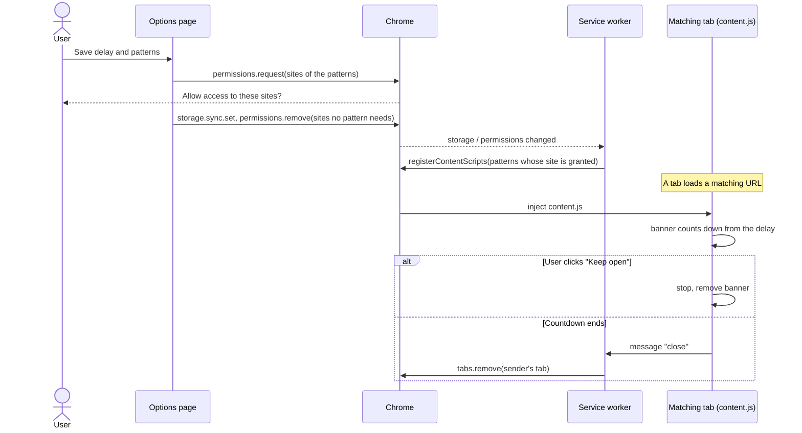

# Tab Auto-Closer

## Context and goal

Links to Slack, Zoom or Teams open a browser tab that hands the link to the desktop app and then stays open. The extensions in the Chrome Web Store that close such tabs ask for access to every site, which is more than this job needs. Tab Auto-Closer closes tabs whose address matches a list of patterns, after a delay, and can read only the sites those patterns name ([ENG-173](https://linear.app/arikkfir/issue/ENG-173)).

## Design

- `settings.js` holds the defaults (3 seconds; Slack's `archives`, `app_redirect` and `ssb/redirect` pages) and validates patterns. Settings live in `chrome.storage.sync`, so they follow the Chrome profile.
- `background.js` registers `content.js` for the patterns whose site the user granted, again whenever the patterns or permissions change, and closes the tab of the content script that asks.
- `content.js` reads the delay, shows a banner in a closed shadow root that counts down with a **Keep open** button, then asks the worker to close its tab. A delay of 0 closes the tab at once, with no banner.
- `options.html` edits the delay and patterns, requests the sites' access on **Save**, gives up the rest, and lists which sites have access.

## Decisions

| Decision                                                            | Why                                                                                                                                                                                     | Rejected                                                                                                                                                                        |
| ------------------------------------------------------------------- | --------------------------------------------------------------------------------------------------------------------------------------------------------------------------------------- | ------------------------------------------------------------------------------------------------------------------------------------------------------------------------------- |
| Content scripts registered at run time on optional host permissions | The extension installs with no site access and no install warning, and reaches only the sites the user granted: patterns can name any site without the manifest asking for all of them. | `tabs` or `webNavigation` to watch every tab's URL from the worker: Chrome warns that it reads the whole browsing history. Fixed `content_scripts` in the manifest: Slack only. |
| Chrome match patterns                                               | They are what `registerContentScripts` and host permissions take, so a pattern needs no translation and its site is its permission.                                                     | Regular expressions or URLPattern: need a URL feed from every tab, which needs the broad permissions above.                                                                     |
| The worker closes the tab                                           | `window.close()` only closes windows a script opened. `tabs.remove` needs no permission.                                                                                                |                                                                                                                                                                                 |
| A countdown banner with **Keep open**                               | Chrome's "Open Slack?" prompt, or a page you meant to read, would otherwise vanish with the tab.                                                                                        | Closing silently.                                                                                                                                                               |
| Narrow Slack defaults                                               | `https://*.slack.com/*` would close the web client (`app.slack.com/client`) too.                                                                                                        |                                                                                                                                                                                 |

## Security and failure modes

- The extension can read and change pages only on the granted sites, and only runs its content script on pages matching a pattern. It sends nothing anywhere.
- A pattern whose site was not granted closes nothing; the options page shows it without access.
- A hand-off page that redirects to the web client before the delay ends unloads the content script, so the tab stays.
- If Slack moves its hand-off pages to other paths, the defaults stop matching until the patterns are updated.

## Rollout

Load it unpacked, or publish it privately to the Chrome Web Store: [README](https://github.com/arikkfir-org/chrome-extensions#readme).
